# Faro — an on-device UI for MeshCore

Faro is a touch, keyboard and trackball UI (LVGL 9.3) for the [MeshCore](https://github.com/meshcore-dev/MeshCore)
companion firmware. It runs on the device next to the normal companion interfaces, so the MeshCore phone app
(BLE) and TCP clients (Wi-Fi, port 5000) keep working while you use the screen.

- **MeshCore:** unmodified upstream `companion-v1.18.0` (`81dbae5`), pinned as the `external/MeshCore` submodule.
  Faro attaches through upstream's `platformio.local.ini` hook and the `AbstractUITask` listener; it adds no
  companion opcodes.
- **Licence:** Apache-2.0 (see `LICENSE`, `NOTICE`, `LICENSES/`, `docs/THIRD_PARTY.md`).
- **Status:** 0.10.2, pre-1.0. Release binaries are 0.10.2 (see `docs/FLASHING.md`). Test it on your own
  hardware before relying on it. 0.10.1 fixed a T-Deck Plus bootloop in the battery ADC that affected 0.10.0;
  0.10.2 lowers idle power draw (screen off after 5 min, dimmer default, Wi-Fi modem off when disabled).

## Download & install

**Firmware:** the [`v0.10.2` release](https://github.com/radek-sixi/sixi-tdeck-plus/releases/tag/v0.10.2)
has one `.bin` per board, a desktop `.deb` and a firmware bundle. Verify with `sha256sum -c SHA256SUMS`.

T-Deck / T-Deck Plus:

| What | File | Flash at |
|---|---|---|
| Full image (first install / recovery) | [`faro-tdeck-0.10.2-merged.bin`](https://github.com/radek-sixi/sixi-tdeck-plus/releases/download/v0.10.2/faro-tdeck-0.10.2-merged.bin) | `0x0` |
| App only (update, keeps keys & contacts) | [`faro-tdeck-0.10.2-app.bin`](https://github.com/radek-sixi/sixi-tdeck-plus/releases/download/v0.10.2/faro-tdeck-0.10.2-app.bin) | `0x10000` |

**Three ways to install:**

1. **Browser, no install (easiest).** Put the T-Deck into download mode (off → hold the trackball → on →
   release; the screen stays dark), connect USB-C, then flash from Chrome/Edge with any
   [ESP Web Tools](https://esphome.github.io/esp-web-tools/) flasher — for example
   [espflasher.app](https://espflasher.app/): choose ESP32-S3, load the `-merged.bin`, flash at `0x0`.
   (Or paste the CORS-enabled URL from `docs/FLASHING.md`.)
2. **Command line.** `esptool` — commands, backup, download mode and rollback in
   [`docs/FLASHING.md`](docs/FLASHING.md).
3. **From source.** `scripts/link_env.sh && pio run -d external/MeshCore -e faro_tdeck -t upload`.

Step-by-step (back up first, then flash, then verify): **[`docs/FLASHING.md`](docs/FLASHING.md)**.

## Screenshots

320×240, rendered with `faro-sim` from the same UI code that runs on the device (made-up contacts and messages).

| Home | Home (dark) | Map | Map (dark) |
|---|---|---|---|
| 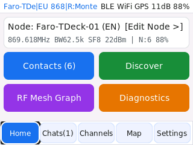 | 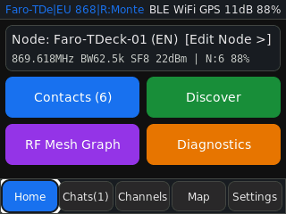 | 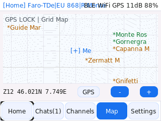 | 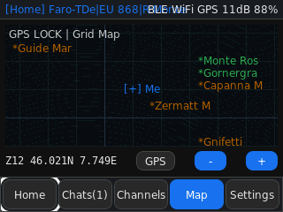 |

| Chat | Channels | Contact | Trace path |
|---|---|---|---|
| 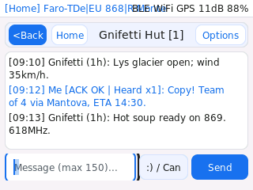 | 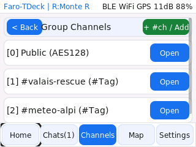 | 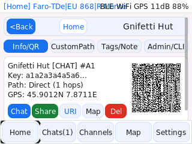 | 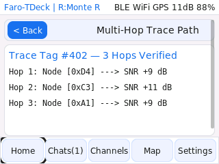 |

| Mesh graph | Diagnostics | Mesh tools | Settings |
|---|---|---|---|
| 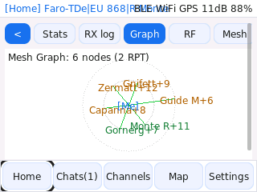 | 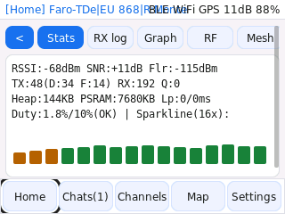 | 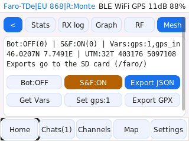 | 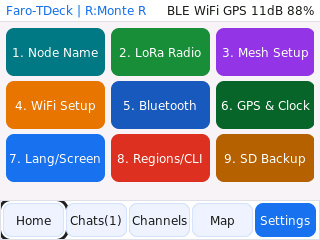 |

| Radio region | Welcome (region) | Node scan | Contact path |
|---|---|---|---|
| 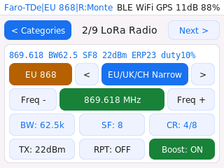 | 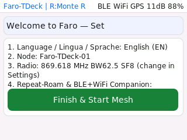 | 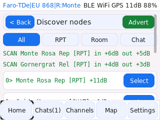 | 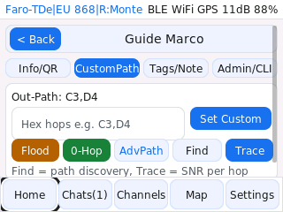 |

More in [`docs/screenshots/`](docs/screenshots/).

## Boards

| Board | Env | Screen UI | Input |
|---|---|---|---|
| LilyGo T-Deck / T-Deck Plus | `faro_tdeck` | yes | touch, keyboard, trackball |
| LilyGo T-Deck MAX | `faro_tdeck_max` | yes | touch, keyboard, trackball |
| Elecrow ThinkNode M9 | `faro_thinknode_m9` | yes | keypad (experimental, see below) |
| LilyGo T-Beam S3 Supreme | `faro_tbeam_supreme` | headless (BLE + Wi-Fi companion) | — |
| Heltec WiFi LoRa 32 V3 | `faro_heltec_v3` | headless (BLE + Wi-Fi companion) | — |

- **SD card** (maps, exports, key backup): T-Deck / T-Deck Plus / T-Deck MAX only.
- **ThinkNode M9:** the keypad (STC8H controller, I2C 0x6C) is the board's only input. Page keys move the focus,
  Enter clicks or sends, Home/Back return to Home, Menu opens Settings, letters type. The arrow-key codes are not
  documented; unknown codes are printed on the serial console. Not yet tested on hardware. The piezo plays the
  message and alarm tones.
- **Headless boards** keep upstream's behaviour for boards without a screen: the BLE PIN is the fixed default
  `123456` (change it in the phone app). Their OLED stays off; the region follows the radio settings you set in
  the phone app (see *Radio regions*).

Also in this repository: a desktop console (`faro-console`, SDL2) that talks to a node over USB or TCP, and a
headless simulator (`faro-sim`) that renders every screen to PNG.

## What it does

Chats and channels (including `#hashtag` channels), contact discovery (adverts and zero-hop scan), QR/URI sharing
and import, path discovery and trace path (SNR per hop), remote administration of repeaters and room servers
(login, status, telemetry, neighbours, ACL, CLI), offline map tiles from the SD card, radio regions, radio and node
settings, diagnostics (RX log, link budget, mesh graph, strongest repeater), GPX tracks, SD backup of settings, and
EN/IT/DE/FR text for the main screens.

What Faro keeps on the device's flash (next to MeshCore's own files): the radio region, UI settings, contact
tags/notes/favourites and the chat history (`/faro_ui.bin`, `/faro_msgs.bin`; written at most once a minute).
`clear history` in Settings › CLI deletes the history; a factory reset deletes everything.

Notes:
- The *RX log* lists the traffic MeshCore hands to the UI (messages, adverts, ACKs, traces, answers to requests).
  Raw RF frames reach only a connected phone app, so it is not a raw packet sniffer.
- *Strongest repeater* (`R:` in the status bar) is shown only; MeshCore routes as always.
- Lists show the 40 most recent contacts (favourites first); filters and search reach all of them.

## Radio regions

Pick the region in Settings › Radio (or on the welcome screen). Each region sets the allowed sub-bands — checked for
the whole channel (centre ± bandwidth/2) — the power ceiling and the duty cycle, and offers the MeshCore community
presets that fit it:

| Region | Sub-bands (MHz) | Power ceiling | Duty cycle | Presets |
|---|---|---|---|---|
| EU/UK/CH 868 | 869.400–869.650 | 27 dBm e.r.p. (500 mW) | 10 % | EU/UK/CH Narrow, Czech, NL, HU/SK, PT, … |
| EU/UK 433 (433 MHz hardware only) | 433.050–434.790 | 10 dBm e.r.p. (10 mW) | 10 % | EU433 Narrow / Long Range, Portugal 433 |
| USA/Canada 915 | 902–928 | 30 dBm conducted, 36 dBm e.i.r.p. | — | USA/Canada, Canada 3-byte, SoCal |
| Australia/NZ 915 | 915–928 | 30 dBm e.i.r.p. | — | Australia (+Narrow, Mid, SA/WA, QLD), NZ Narrow, NZ Gisborne |
| Brazil 915 | 902–907.5, 915–928 | 30 dBm e.i.r.p. | — | Brazil |

- Power is capped for the antenna gain `FARO_ANTENNA_GAIN_DBI` (3 dBi by default; e.r.p. = conducted + gain −
  2.15 dB, e.i.r.p. = conducted + gain). The radio's own limit is 22 dBm, so the cap only bites in EU 433 or with
  high-gain antennas.
- The duty cycle is enforced through MeshCore's airtime factor (10 % = factor 9). MeshCore cannot go below 10 %,
  which is why regions that need less (e.g. Vietnam, 1 % for end devices) are not offered.
- Settings changed outside Faro — the phone app, a TCP client or `set radio` in the CLI — are checked every second:
  inside a region they are accepted (the region follows, power and duty are clamped); outside every region the
  previous settings are restored. The change is shown in Settings › Radio and printed on the serial console.
- At boot, stored settings that fit no region (for example from another firmware) are replaced by the region's first
  preset.

These are firmware ceilings, not legal advice: national rules can be stricter (in the USA, for example, a fixed
narrow LoRa channel is not "digital modulation" under FCC 15.247). You are responsible for operating within the
rules of your country.

## Security notes

- The Wi-Fi companion port (TCP 5000) is upstream MeshCore's and has **no authentication**: anyone on the same
  network can use it like the phone app. Only enable Wi-Fi on networks you trust.
- Private-key import/export over the companion protocol is **off**: upstream enables it by default, Faro builds
  remove it, so neither TCP clients nor a paired phone can read or replace the node key. A key backup to the SD
  card is possible from Settings › SD after a confirmation tap; the file is not encrypted, so remove it from the
  card when done.
- New private channels get a random key from the hardware RNG. `Public` and `#name` channels have well-known keys.
- BLE PIN: random on screen-equipped boards, `123456` on headless boards (upstream default); weak PINs (123456,
  repeated or sequential digits) are refused when set on the device.
- Message text is never written to the serial log. The chat history is stored unencrypted on the device's flash
  (see *What it does*).

Report vulnerabilities as described in `SECURITY.md`.

## Building

```sh
git clone --recurse-submodules https://github.com/radek-sixi/sixi-tdeck-plus.git
cd sixi-tdeck-plus
scripts/link_env.sh                                  # links envs/faro.ini into the MeshCore submodule
pio run -d external/MeshCore -e faro_tdeck           # firmware
cmake -S . -B build && cmake --build build -j && ctest --test-dir build   # host tests, sim, console
```

`docs/FLASHING.md` explains how to flash and how to keep your existing MeshCore identity.

## Maps

`scripts/make_sd_map.py` prepares tiles for the SD card from a tile server **you** choose; it refuses the
OpenStreetMap tile servers, whose usage policy forbids bulk downloads. Map data © OpenStreetMap contributors
where OSM data is used.
